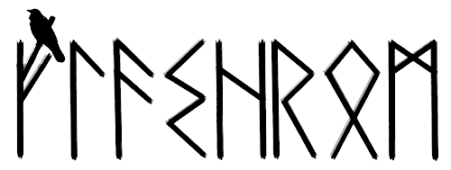

.. flashrom documentation master file, created by
   sphinx-quickstart on Mon Jan 30 17:34:19 2023.
   You can adapt this file completely to your liking, but it should at least
   contain the root `toctree` directive.

.. toctree::
  :hidden:

  dev_guide/index
  user_docs/index
  contrib_howtos/index
  supported_hw/index
  classic_cli_manpage
  contact
  release_notes/index
  about_flashrom/index
  how_to_support_flashrom
  how_to_add_docs
  documentation_license

.. include:: intro.rst

.. include:: ../README.rst
